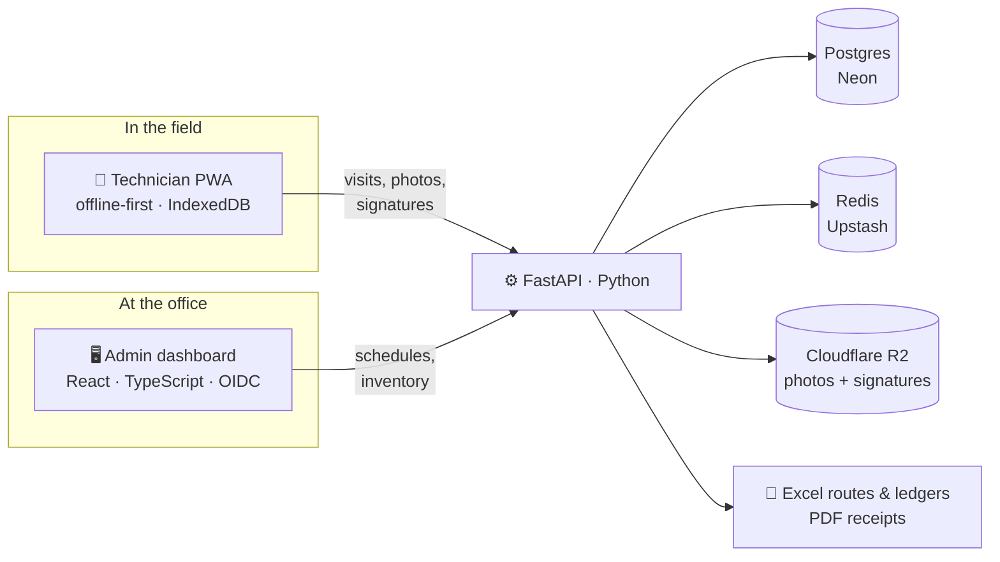

<div align="center">

[](https://www.linkedin.com/in/alejandromermon/)
[](mailto:alejandromermon@gmail.com)
[](https://alejandromermon.netlify.app/)
[](https://drive.google.com/file/d/1s4PDeSNH807DK4NLwBSGHIyTJHPgt0Fn/view?usp=sharing)

</div>

I build software that replaces messy processes: paper forms, spreadsheets retyped by hand, workflows that live in someone's inbox. I write the code, figure out what the business actually needs, and stay until people are using what I built.

Right now that means internal tools and AI prototypes at Nestlé Canada, and an operations platform called AromaLab that I'm building on the side.

I'm in Toronto, and I'm looking for my next role as a **Full-Stack, Frontend or Product Engineer**.

```ts
const player1 = {
  name: "Alejandro Mercado",
  class: "Full-stack developer / product engineer",
  base: "Toronto, ON",
  origin: "Mexico",
  guild: "Nestlé Canada",
  mainQuest: "AromaLab",
  weapons: ["TypeScript", "JavaScript", "Python", "C#"],
  gear: ["React", "Next.js", "React Native", ".NET", "NestJS", "FastAPI"],
  shield: "Playwright",
  spells: ["Power Platform", "Microsoft's AI tools"],
  offline: ["bass 🎸", "Rocket League", "Zelda"],
} as const;
```

---

## 🗺️ Quest log

| | Quest | Status | |
|:-:|---|---|---|
| ⚔️ | **Main quest: AromaLab** | In progress · alpha | Replacing a company's paper-and-Excel field operations with software. [↓](#️-main-quest-aromalab) |
| 🏰 | **Guild: Nestlé Canada** | In progress | Building internal tools and AI prototypes, and teaching people to build their own. [↓](#-guild-nestlé-canada) |
| 🕹️ | **Next quest** | 🔒 Locked | Join your team. [Unlock it](mailto:alejandromermon@gmail.com) |

---

## ⚔️ Main quest: AromaLab

AromaLab is a scent-marketing company in Mexico. Its technicians visit client locations to service scent diffusers, and every visit used to live on paper and then get retyped into Excel. I'm replacing that whole workflow, in my free time.

> **The boss:** paper forms → someone retypes them into Excel → reports built by hand.<br>
> **After the fight:** technicians log visits on their phones, even with no signal. The office gets the schedule, the Excel reports and the PDF receipts generated for it.



**Abilities unlocked**

- **Offline mode.** Technicians install the app from a one-time link that expires in 15 minutes. Visits, photos and client signatures are saved on the phone and uploaded in one safe step when they're back online.
- **Auto-scheduler.** A Python scheduler fills the month around holidays, time off and each technician's daily capacity. Anything that doesn't fit lands in an "Unassigned" pool, so nothing gets quietly dropped. The admin can then fine-tune it on a drag-and-drop calendar.
- **Backwards compatibility.** The business still runs on Excel and paper, so the system generates the same route sheets, ledgers and receipt PDFs they already know.
- **Language select.** The interface is in Spanish by default, with English one toggle away.
- **Co-op discipline, solo player.** I keep a written "constitution" with the project's rules and decisions, and work flows from feature branches through staging into production by PR.

<table>
  <tr>
    <td align="center"><b>220+</b><br><sub>commits</sub></td>
    <td align="center"><b>37</b><br><sub>merged PRs</sub></td>
    <td align="center"><b>3</b><br><sub>apps in one monorepo</sub></td>
    <td align="center"><b>4–6</b><br><sub>alpha testers in the field</sub></td>
  </tr>
</table>

**Bonus level:** I also built a storefront prototype for AromaLab, in Spanish, with the payment options Mexican shoppers expect: card installments (MSI), OXXO, SPEI and Mercado Pago.

<sub>The code is private. I'm happy to walk you through it on a call.</sub>

---

## 🏰 Guild: Nestlé Canada

I'm an **Associate Product Owner** on the Technical Solutions & Architecture team. My stat points, roughly:

```text
CODE   (React, JavaScript, Python)    ███░░░░░░░░░░░░░░░░░  15%
BUILD  (Power Platform)               ███░░░░░░░░░░░░░░░░░  15%
SUPPORT (teaching + architecture)     ██████████████░░░░░░  70%
```

- **I build AI prototypes.** Nestlé is in Microsoft's Frontier program, so I build proofs of concept on Microsoft's AI tools. My favourite manages internal assets, enforces governance rules, runs health checks, and uses AI to help people document what they've built. It's expected to ship in November 2026.
- **I level up the party.** I've supported 300+ employees through enablement and team sessions, then reviewed and designed the architecture for what they built.
- **I refreshed the Citizen Development site.** Visits and time on page rose 35%.

I started at Nestlé as a C# / .NET web developer intern in 2025, moved to a Data & Analytics contract, and then into this role.

---

## 📜 Completed quests

**[Compass for Two](https://path-planner-chi.vercel.app)** · a goal tracker for couples, designed like a cozy game. Each partner does a weekly check-in, and once a month the app turns at-risk goals into a meeting agenda you click through as slides. Progress earns XP, levels, streaks and badges, and there's a garden that grows as goals move forward. It syncs between two phones without a backend, by merging exported records and keeping the newest version of each. [**Play it →**](https://path-planner-chi.vercel.app)

**himigo** · Full-Stack Developer, Dec 2024 – Sep 2025. I split my time evenly between frontend and backend. I built on the Partners platform, which let 30+ employers manage 100+ job applications, and contributed to the mobile app (1,500+ users) with React Native and NestJS. I also wrote the Playwright end-to-end tests that cut down regressions.

<details>
<summary><b>Side quests</b></summary>
<br>

| Project | What it is | |
|---|---|---|
| Lego Collection | The same Node/Express app, built once on PostgreSQL and once on MongoDB | [Postgres](https://lego-sets-postgres.vercel.app) · [MongoDB](https://lego-sets-mongo-db.vercel.app) |
| Countries Explorer | Next.js + GraphQL search | [Live](https://himigo-test.vercel.app) · [Code](https://github.com/alejandromermon/himigo-test) |
| Listings API | REST API in Node.js | [Live](https://listings-api-seven.vercel.app) |
| Advanced OOP in C++ | Inheritance, templates, memory management | [Code](https://github.com/alejandromermon/Advanced-Object-Oriented-Programming) |

</details>

---

## 🏆 Achievements unlocked

<table>
  <tr>
    <td align="center" width="20%"><h3>300+</h3><b>Party leader</b><br><sub>Nestlé employees supported through enablement</sub></td>
    <td align="center" width="20%"><h3>1,500+</h3><b>Crowd favourite</b><br><sub>users on the himigo app I worked on</sub></td>
    <td align="center" width="20%"><h3>+35%</h3><b>Level up</b><br><sub>visits and time on page after my site refresh</sub></td>
    <td align="center" width="20%"><h3>3rd / 200+</h3><b>Podium finish</b><br><sub>teams at the Seneca Housing Hackathon 2024</sub></td>
    <td align="center" width="20%"><h3>100+</h3><b>Matchmaker</b><br><sub>job applications managed by 30+ employers on himigo Partners</sub></td>
  </tr>
</table>

---

## 💾 Save file

<details>
<summary><b>Story so far</b></summary>
<br>

| When | Where | What |
|---|---|---|
| → 2025 | Seneca Polytechnic, Toronto | Computer Programming diploma (4.0 GPA), lab assistant, and 3rd place out of 200+ teams at the Housing Hackathon |
| 2024 – 2025 | himigo | Full-stack developer |
| 2025 → now | Nestlé Canada | Web developer intern → Data & Analytics → Associate Product Owner |
| 2026 → now | AromaLab | Designing and building its operations platform |

I also hold a bachelor's degree from Mexico, earned before I moved to Canada.

</details>

<details>
<summary><b>Inventory</b></summary>
<br>

[](https://skillicons.dev)

Also: Playwright, React Native, Microsoft Power Platform, generative-AI apps.

</details>

---

<div align="center">

<picture>
  <source media="(prefers-color-scheme: dark)" srcset="https://raw.githubusercontent.com/alejandromermon/alejandromermon/output/github-snake-dark.svg" />
  
</picture>

### 🕹️ Player 2, press start

Looking for a co-op partner on a full-stack, frontend or product engineering team?

**[alejandromermon@gmail.com](mailto:alejandromermon@gmail.com)** · [LinkedIn](https://www.linkedin.com/in/alejandromermon/)

</div>
